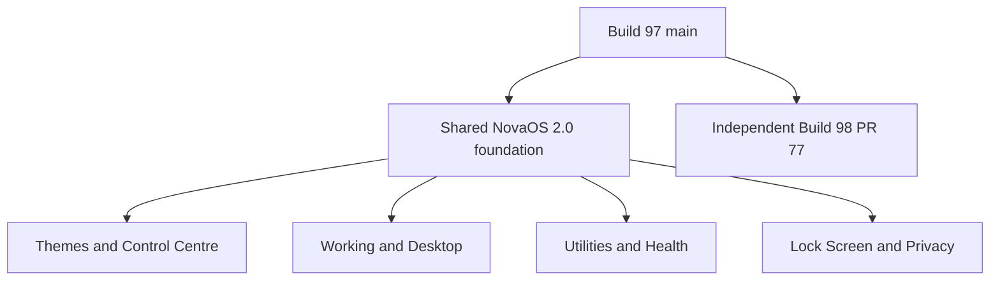

# NovaOS 2.0 master plan

## Baseline and scope

`main` was recovered at `b19610a7efb3df53edcec2610402c69ea8e1199c`. The last stable tag is `v1.7.51` at `6b7f1bbe40db3f213ff087833f37e05954e1c792` (Build 97). The difference at the tip includes the protected Build 98 rehearsal control. The unmerged Build 98 [PR #77](https://github.com/traynor1987/Private-gallery-/pull/77) is independent at `7e40ab1f625cb845350115e45aed444129a7333e`. The project compiles against Android 37.1 and targets and requires API 37. Development keeps `uk.co.traynor.privategallery` and the existing version values. The Android acceptance lane uses the existing isolated debug identity. Samsung Galaxy Z Fold physical acceptance remains an owner activity.

The prior [NovaOS shell design](../superpowers/specs/2026-11-01-novaos-design.md), [cohesive app design](../superpowers/specs/2026-11-01-novaos-apps-design.md) and [release policy](../release-policy/POLICY.md) establish the existing native shell, owner-scoped encryption and change-aware evidence. `VisualStudios`, `VisualPrivacy` and `VisualHealthTimeDesign` contain illustrative screens. Their samples are design references and are excluded from real system status.

## Feature inventory

| Workstream | Existing production capability | Development scope and boundaries |
| --- | --- | --- |
| Themes Studio | `LauncherAppearance`, launcher layout codec, `LauncherWallpaperView`, folder preferences, separate cover/inner placements | Three original styles, appearance-only preview/apply/restore and portable presets. Themes may change rendering and density, preserving app placement, folders, Hidden exclusions and widget identity. |
| Working / Driving | Sanctuary launch decisions, real launcher catalogue, Android foreground location permission declarations | Manual work/driving session, foreground GPS readout with age/accuracy, owner-recorded shift values and profile-aware app shortcuts. Verified speed-limit, camera and Shift Tracker feeds require a separate documented and authenticated source. Motion is never driver identity. |
| Control Centre | Workspace quick panel, launcher navigation gestures, status and Guardian safe Inbox | Compose quick panel using public APIs and system panels, encrypted per-display arrangement and permission-gated media. Reuse the Guardian listener and read-only status. |
| Lock Screen Studio | Real system/device locking and separate protected Nova spaces. Existing style prototype | Preview original lock styles. Confirm supported wallpaper changes and hand off system configuration to Android. Device keyguard, clock rendering, AOD and unlock authentication stay under system control. |
| Desktop | Existing Fold launcher layout and authenticated internal apps. Existing desktop prototype | Adaptive inner workspace, resizable Nova panels, pins and keyboard/mouse support. External activities retain Android window policy and Sanctuary checks. |
| Health & Mind | Encrypted Space-specific Nova Mind journal, mood and breathing. Read-only Sanctuary history | Authenticated Primary Health page, manual data, trends and reflection, optional Health Connect. Samsung Health, Watch and WHOOP availability depends on authorised records or explicit documented providers. |
| Privacy Dashboard | NovaOS runtime permission grants, Guardian, Sanctuary, VPN and encrypted backup settings | Live app-scoped permission and protection status, public Android privacy panels and safe backup/consent summaries. Ordinary screens disclose neither the Hidden domain nor any Hidden-only routing status. |
| Utilities | Authenticated Notes, Tasks, Calendar, Files and Clipboard. `LauncherSmartTracking` Usage Access. Existing `NovaUpdateModel` | Reuse the five encrypted core apps and verified updater. Add Contacts, permission-scoped usage and an owner-approved share intake wherever the existing workspace permits. |

## Architecture and branch dependency

- Each feature targets the foundation branch in an independent review. Optional cross-feature shortcuts appear only when their destination is registered. An unregistered system has no launcher entry. Use a private integration branch to exercise combined features after their individual checks.
- The foundation uses the existing launcher render and launch dispatcher, Compose theme and adaptive width. Reuse Material colour, spacing and typography roles. Keep the cover layout single-column when space is constrained. Use labelled touch targets and respect system font scale and keyboard insets.
- Public feature settings use namespaced, bounded, atomic AES-GCM records through the existing device-local store. Primary health and shared private records use authenticated Space storage. Existing presets and explicit user exports are separate from the established encrypted backup mechanism. A new portable schema requires reader compatibility and populated restore evidence before release.
- Use explicit activation and recheck permissions and lifecycle at the action boundary. Bring up native system settings where direct control requires wider privileges. Suspend private presentations on protection changes. Preserve the existing drive-independent emergency calling, Guardian, Sanctuary, app identity and backup/access authorities.
- The shared Foundation is Wave A. Publish production serially by wave only after separate owner authorisation. Wave A covers Themes and Control Centre, Wave B Working and Desktop, Wave C Utilities and Health, and Wave D Lock Screen and Privacy. Re-evaluate Build 98 at a separately reviewed integration point. Keep signing, populated encrypted upgrade and in-app update verification as release gates for the exact promoted source.

## Android design constraints

- Foreground location samples must have usable accuracy and a recent timestamp. A future background integration must have a legitimate documented use, separate permission approval and a visible service. See [Android location permissions](https://developer.android.com/develop/sensors-and-location/location/permissions) and [foreground service types](https://developer.android.com/about/versions/14/changes/fgs-types-required).
- Android 17 restricts local-network access and ordinary app target-side privileges. External display launch must satisfy Android eligibility and preserve existing activity security. See [Android 17 changes](https://developer.android.com/about/versions/17/summary) and [connected displays](https://developer.android.com/develop/adaptive-apps/guides/support-connected-displays).
- Android exposes supported lock wallpaper through `WallpaperManager.FLAG_LOCK`. Galaxy device Keyguard, OEM clock controls and AOD remain OS features. See [WallpaperManager](https://developer.android.com/reference/android/app/WallpaperManager) and [KeyguardManager](https://developer.android.com/reference/android/app/KeyguardManager).
- Health Connect requires per-data-type grants and handles provider attribution. External data appears only after an owner grant and a successful query. No health data is forwarded to Guardian or provider APIs. See [Health Connect setup](https://developer.android.com/health-and-fitness/health-connect/get-started) and [reading Health Connect data](https://developer.android.com/health-and-fitness/health-connect/read-data).

## Regression matrix and evidence requirements

| Change | Local and API 37 verification | Physical Fold and release follow-up |
| --- | --- | --- |
| Shared launcher route or visual tokens | Registered route opens, Back returns to origin, disabled/protected state removes entry, original launcher and app dispatch remain | Cover and inner, portrait and landscape, light and dark, font scale, haptics, keyboard, folding and recreation |
| Theme codec | Round trip, older layout compatibility, corrupt import rejection, appearance-only application, wallpaper/widget fallback | Existing pages, folders, dock, widgets and wallpaper maintained after process restart and upgrade |
| Driving or quick controls | Permission denied, no GPS/stale samples, airplane mode, settings fallback, no activation by motion alone, protected foreground | Stationary visual test first, mounted readable dashboard, navigation and emergency access, list of approved apps, measured sample lifetime and battery |
| Lock and Desktop | Declined system action, unsupported wallpaper/display, resize bounds, keyboard focus, no keyguard bypass | System unlock, emergency entry, lock wallpaper and orientation, cover/inner transitions, external display where available |
| Health, Utilities and Privacy | Grant denied/revoked, no fake data, authenticated encrypted records, scoped import/export and deletion, redaction, no secret output | Real owner-authorised inputs, privacy settings handoff, protected screenshots, reboot, backup/restore compatibility |
| Release integration | Existing Guardian notification replacement, no Hidden or Sanctuary regression. Confirm package, original certificate, populated encrypted upgrade and updater on verified source | Owner installs only through existing updater after a separately authorised publication. Record the device result explicitly. |

Collect API 37 workflow links, exact source SHA, test counts, any security carry-forward evidence and labelled emulator images. Record failures and unavailable physical or external integration evidence. Use synthetic fixtures in screenshots and logs. A passing emulator is development evidence.

## Owner acceptance checklist

- [ ] Theme switches and imports preserve the current launcher layouts on both displays.
- [ ] Working Mode has safe stationary controls, accurate available status and explicit, accurate unavailable states.
- [ ] Control Centre opens from Nova Home, respects permission denial, and keeps Guardian notifications working.
- [ ] Lock wallpaper and preview behave as indicated. System unlock and emergency access stay available.
- [ ] Desktop keeps workspace selections across fold and orientation changes, with working launch and supported input.
- [ ] Health records remain private, survive restart and honor external opt-in, export and delete.
- [ ] Privacy Dashboard reports only observable status and reveals no protected Space or message content.
- [ ] Utility shortcuts open their established apps. Sharing, usage and update checks report the real result.
- [ ] The change-aware release evidence and signed populated upgrade pass before any production promotion.
